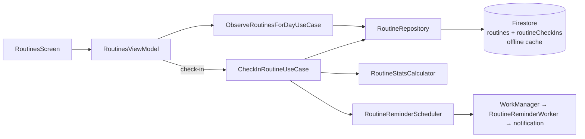

# Daymark Routines — Build Plan

> A recurring‑commitment tracker modelled on the habit screens in the reference screenshots, built as **Routines** inside Daymark. This document is the implementation plan: product definition, domain rules, data model, UI spec, architecture, algorithms, tests, phases and open decisions. Nothing here is implemented yet.

---

## 0. TL;DR

| Reference screen | Daymark equivalent | Route |
|---|---|---|
| **Habit list** — header "Habit ▾ ⊞ + ⋯", 7‑day strip with per‑day status, "Oct 27 ×" date chip, habit card with ⚡ total / 🔥 streak and a check button | **Routines** screen | `Route.Routines` |
| **Habit detail** — emoji + name, 4 stat tiles (monthly check‑ins, total, monthly rate, current streak ⇄), month calendar with checked days, "Habit Log on October" | **Routine detail** (full screen on phone, side sheet on tablet) | `Route.RoutineDetail(id)` |
| **Create Habit** dialog — emoji, name, Frequency, Goal, Start Date, Goal Days, Section, Reminder +, "Auto pop‑up of habit log" | **New / Edit routine** (full‑screen dialog) | `Route.AddEditRoutine(id?)` |

Scope v1: binary check‑ins, four frequency types, duration ("goal days"), sections (reuse Categories), multiple daily reminders, notes after check‑in, streaks and monthly stats, offline‑first. Estimated **10–14 dev‑days** across 6 phases (§9).

---

## 1. Product definition

### 1.1 What a Routine is (and is not)

| | Task (exists) | **Routine (new)** |
|---|---|---|
| Lifetime | One‑off; done once | Recurring; never "done", you **check in** per scheduled day |
| Date | Optional due date | Schedule (frequency) + start date + optional duration |
| Progress | Completed / not | Check‑in history → total, streak, monthly rate |
| Lives in | Home / lists | Its own **Routines** screen (+ a summary card on Home) |

### 1.2 Terminology (habit → routine)

| Screenshot term | Daymark term | Notes |
|---|---|---|
| Habit | **Routine** | everywhere: UI strings, routes, Firestore collections, classes |
| Check‑in | **Check‑in** | keep — it is the natural verb for a routine too |
| Habit Log | **Routine notes** ("Notes for October") | the per‑check‑in text |
| Section | **Section** | backed by existing **Categories** (`Others` = no category) — no second taxonomy |
| Goal · *Achieve it all* | **Goal** · *Just do it* / *Reach a target* | target = count + unit (e.g. 20 pages); target goals are v1.1 |
| Goal Days · *Forever* | **Duration** · *Ongoing* / 7 / 21 / 30 / 100 / 365 days | number of **check‑ins** to reach; ⓘ tooltip explains |
| Auto pop‑up of habit log | **Ask for a note after check‑in** | opens the note sheet right after a check‑in |

### 1.3 User stories & acceptance criteria

1. **Create** — I can create a routine with emoji, name, frequency, goal, start date, duration, section, reminders and the note toggle. *AC: name required; "specific days" needs ≥ 1 day; start date defaults to today; the routine appears in the list immediately (offline too).*
2. **Check in** — From the list I tap the circle to check in for the selected day; tapping again undoes it. *AC: < 100 ms feedback, haptic, animation; works offline; survives app restart; idempotent when the same check‑in syncs twice.*
3. **See the week** — A 7‑day strip shows, per day, whether all / some / none of the scheduled routines were done; tapping a day filters the list to that day and shows a "Oct 27 ×" chip; × returns to today. *AC: days before any routine existed show the hatched "n/a" marker; future days are not tappable.*
4. **Understand progress** — A card shows ⚡ total check‑ins and 🔥 current streak; the detail screen shows the four tiles, a month calendar and this month's notes. *AC: numbers match the definitions in §7 exactly; unit‑tested.*
5. **Back‑fill** — In the detail calendar I can toggle a past day I forgot (within 30 days). *AC: streak/stat tiles update instantly.*
6. **Be reminded** — Each routine can have 0‑n reminder times; a notification fires on scheduled days only, with **Check in** / **Skip** / **Later** actions. *AC: no notification if already checked in; reminders survive reboot and app update.*
7. **Manage** — Edit, archive (hide, keep history), delete (with confirmation), reorder, filter by section, show archived.
8. **Finish** — When a duration target is reached the routine celebrates and offers *Archive* / *Keep going*.

### 1.4 Out of scope for v1
Numeric/unit goals (v1.1), routine *steps* checklist (v2 — the thing that makes a "routine" more than a habit), overview/statistics screen (the ⊞ icon), widgets, sharing, charts beyond the month calendar, custom day‑start hour.

---

## 2. Domain model

```kotlin
// domain/model/routine/Routine.kt
enum class FrequencyType { DAILY, SPECIFIC_DAYS, DAYS_PER_WEEK, EVERY_N_DAYS }

data class RoutineFrequency(
    val type: FrequencyType = FrequencyType.DAILY,
    val days: Set<DayOfWeek> = emptySet(),   // SPECIFIC_DAYS
    val count: Int = 1                        // DAYS_PER_WEEK → n per week · EVERY_N_DAYS → interval
)

enum class GoalType { JUST_DO_IT, REACH_TARGET }
data class RoutineGoal(val type: GoalType = GoalType.JUST_DO_IT, val target: Int = 1, val unit: String = "")

data class Routine(
    val id: String = "",
    val name: String = "",
    val emoji: String = "🙂",
    val colorHex: String = "#D6E4FF",            // from CategoryPaletteHex
    val frequency: RoutineFrequency = RoutineFrequency(),
    val goal: RoutineGoal = RoutineGoal(),
    val startDate: LocalDate,                     // local date, never a timestamp
    val targetCheckIns: Int? = null,              // "Duration": null = ongoing
    val categoryId: String? = null,               // "Section"
    val reminders: List<LocalTime> = emptyList(),
    val askForNote: Boolean = false,
    val order: Int = 0,
    val isArchived: Boolean = false,
    val createdAt: Long, val updatedAt: Long,
    // denormalised, maintained by CheckInRoutineUseCase, re-derived on detail open
    val totalCheckIns: Int = 0,
    val currentStreak: Int = 0,
    val bestStreak: Int = 0,
    val lastCheckInDate: LocalDate? = null
)

enum class CheckInStatus { DONE, SKIPPED }
data class RoutineCheckIn(
    val routineId: String,
    val date: LocalDate,                          // the routine day, in the device zone
    val status: CheckInStatus = CheckInStatus.DONE,
    val value: Int = 1,                           // REACH_TARGET progress; 1 for JUST_DO_IT
    val note: String = "",
    val checkedAt: Long
) { val id get() = "${routineId}_$date" }        // deterministic → idempotent writes
```

Why `LocalDate`/`LocalTime` and not epoch millis: a check‑in belongs to a **calendar day**, not an instant. Storing `"2026-10-27"` avoids every time‑zone/DST bug class and makes Firestore range queries trivial (ISO strings sort correctly). `java.time` is already in use (desugaring is on, `minSdk 24`).

### 2.1 Rules in one place — `RoutineSchedule` (pure Kotlin)

| Rule | Definition |
|---|---|
| `isScheduled(routine, date)` | `date ≥ startDate` and not archived and: DAILY → true · SPECIFIC_DAYS → `date.dayOfWeek ∈ days` · EVERY_N_DAYS → `daysBetween(startDate, date) % count == 0` · DAYS_PER_WEEK → true (any day may count; the *week* has a quota) |
| Week | Monday‑start for quota math (ISO); the **strip/calendar** render Sunday‑first like the reference, configurable later |
| Day boundary | Device zone, midnight. (A "day starts at 4 AM" setting is a later option; everything flows through one `Clock` so it is a one‑line change.) |
| Back‑fill window | 30 days (configurable constant) |
| Completion (`targetCheckIns`) | reached when `totalCheckIns ≥ targetCheckIns` → "achieved" state, suggest archive |

---

## 3. Data layer (Firestore, offline‑first)

```
users/{uid}/routines/{routineId}
  name, emoji, colorHex, frequencyType, frequencyDays:[1..7], frequencyCount,
  goalType, goalTarget, goalUnit, startDate:"yyyy-MM-dd", targetCheckIns:int|null,
  categoryId, reminders:["07:30","21:00"], askForNote, order,
  archived:bool, createdAt, updatedAt,
  totalCheckIns, currentStreak, bestStreak, lastCheckInDate

users/{uid}/routineCheckIns/{routineId}_{yyyy-MM-dd}      ← flat, NOT a sub-collection
  routineId, date:"yyyy-MM-dd", status:"DONE"|"SKIPPED", value, note, checkedAt
```

**Why a flat check‑in collection:** the list screen needs "all check‑ins of all routines for 7 days" → **one** query `where date >= weekStart && date <= weekEnd` → one listener, regardless of routine count. The detail screen needs one routine's month → `where routineId == X && date >= m1 && date <= m31`. A sub‑collection would need N listeners or a collection‑group query with extra rules.

**Why denormalised counters on the routine doc:** the list card shows ⚡ total and 🔥 streak for every routine without loading full histories. `CheckInRoutineUseCase` updates them in a single **batched write** together with the check‑in doc (local‑first, so it is instant offline). The detail screen recomputes from the month/all check‑ins and silently repairs drift.

| Concern | Decision |
|---|---|
| Boolean field names | Firestore drops the `is` prefix — follow `TaskDto`'s `@PropertyName("archived")` pattern |
| Soft delete | `deleted:true` like tasks; check‑ins kept for 30 days then purged by the client on next open (or left — they are tiny) |
| Indexes | `routineCheckIns`: composite `(routineId ASC, date ASC)`; `routines`: `(deleted ASC, archived ASC, order ASC)` → add to `firestore.indexes.json` |
| Rules | Already covered by `match /users/{uid}/{document=**}`; add field validation for `date` format and `status` enum (optional hardening) |
| Offline | Firestore persistence is already enabled; deterministic IDs make retries idempotent |

### 3.1 Repository contract

```kotlin
interface RoutineRepository {
    fun observeRoutines(includeArchived: Boolean = false): Flow<Result<List<Routine>>>
    fun observeRoutine(routineId: String): Flow<Result<Routine>>
    suspend fun saveRoutine(routine: Routine): Result<String>          // add or update
    suspend fun setArchived(routineId: String, archived: Boolean): Result<Unit>
    suspend fun deleteRoutine(routineId: String): Result<Unit>
    suspend fun reorder(orderedIds: List<String>): Result<Unit>

    fun observeCheckIns(from: LocalDate, to: LocalDate): Flow<Result<List<RoutineCheckIn>>>          // list/week strip
    fun observeCheckIns(routineId: String, from: LocalDate, to: LocalDate): Flow<Result<List<RoutineCheckIn>>> // detail/month
    suspend fun allCheckIns(routineId: String): Result<List<RoutineCheckIn>>                       // best streak / repair
    suspend fun upsertCheckIn(checkIn: RoutineCheckIn, counters: RoutineCounters): Result<Unit>     // batched with routine doc
    suspend fun removeCheckIn(routineId: String, date: LocalDate, counters: RoutineCounters): Result<Unit>
}
```

### 3.2 Use cases

| Use case | Responsibility |
|---|---|
| `ObserveRoutinesForDayUseCase(date)` | combine routines + week check‑ins → `List<RoutineRowUi>` (scheduled‑today flag, done flag, totals, streak) + `WeekDayStatus × 7` for the strip |
| `CheckInRoutineUseCase(routineId, date, status, note?)` | validate (date in back‑fill window, scheduled or DAYS_PER_WEEK), recompute counters via `RoutineStatsCalculator`, batched write, cancel today's remaining reminders |
| `UndoCheckInUseCase` | inverse, recompute counters |
| `SaveRoutineUseCase` | validation, defaults, `order = max+1`, reschedule reminders |
| `ArchiveRoutineUseCase` / `DeleteRoutineUseCase` | state change + cancel reminders |
| `ObserveRoutineDetailUseCase(routineId, month)` | routine + month check‑ins (+ all check‑ins once for best streak) → `RoutineDetailStats` |
| `RoutineStatsCalculator` (object) | **pure functions** for everything in §7 — the only place with date math |
| `SyncRoutineRemindersUseCase` | on login/app start: (re)schedule next reminder for every active routine |

---

## 4. Reminders

Reuse the existing WorkManager pipeline (`ReminderScheduler` / `ReminderWorker` / `ReminderActionReceiver` / `NotificationHelper`) with a routine‑specific worker:

```
RoutineReminderScheduler.scheduleNext(routine)
  next = first (date, time) ≥ now where isScheduled(date) and no DONE check-in on that date
  enqueueUniqueWork("routine_reminder_${id}_${time}", REPLACE, OneTimeWork(delay = next - now))

RoutineReminderWorker.doWork()
  if routine archived/deleted → finish
  if already checked in today → skip notification
  else notify(channel "Routines", actions: Check in · Skip today · Later (1 h))
  scheduleNext(routine)            // self-chaining; no periodic work needed
```

| Point | Decision / note |
|---|---|
| Exactness | WorkManager is inexact (typically ±10 min under Doze). Acceptable for routines; an **exact‑alarm opt‑in** (`AlarmManager.setExactAndAllowWhileIdle` + `SCHEDULE_EXACT_ALARM`) is a later setting for users who want 07:00 sharp |
| Reboot / update | WorkManager persists its queue → no boot receiver needed (unlike AlarmManager) |
| Healing | `SyncRoutineRemindersUseCase` runs on app start and after sign‑in (new device, reinstall) |
| Actions | `ReminderActionReceiver` gains `ACTION_ROUTINE_CHECK_IN`, `ACTION_ROUTINE_SKIP`, `ACTION_ROUTINE_SNOOZE` → call the use cases directly (Hilt `@AndroidEntryPoint` receiver) |
| Channel | new channel `routines` (default importance, no sound by default) |
| Permissions | `POST_NOTIFICATIONS` already requested; reuse the same prompt flow |

---

## 5. UI specification (Compose · Material 3 · existing design system)

### 5.1 Navigation & entry points
- New routes in `Routes.kt`: `Routines`, `RoutineDetail(routineId)`, `AddEditRoutine(routineId: String? = null)`; wire in `SabihonNavHost.kt`; `MainScaffold` shows the bottom bar on `Routines`.
- Entry points: **Home** — a "Routines today · 2 of 4 done" card with emoji avatars (tap → Routines screen); **Settings** → Routines; optional later: swap the *History* tab for *Routines* (decision D2 in §10).

### 5.2 Routines screen (list)

```
┌────────────────────────────────────────────┐
│ Routines ▾                        +   ⋯    │  ▾ = section filter (All · Work · Personal · … · Archived)
│  Wed  Thu  Fri  Sat  Sun  Mon [Tue]        │  week strip: swipe ← for earlier weeks
│   21   22   23   24   25   26 [ 27]        │
│   ⊘    ⊘    ⊘    ⊘    ⊘    ◔  [ ✓ ]        │  ⊘ n/a · ○ none done · ◔ some · ● all · selected column tinted
│ 🏷 Oct 27 ×                                │  only when a day other than today is selected
│ ┌──────────────────────────────────────┐   │
│ │ (🙂) Guitar practice            ( ✓ )│   │  card: emoji on tinted circle · name · ⚡ 1 day  🔥 1 day
│ │      ⚡ 1 day  🔥 1 day               │   │  right: CheckInButton (tap = check in · long-press = skip / note / undo)
│ └──────────────────────────────────────┘   │
│ ┌──────────────────────────────────────┐   │
│ │ (📖) Read 20 pages              (   )│   │  unchecked state: outlined circle
│ │      ⚡ 12 days  🔥 4 days            │   │
│ └──────────────────────────────────────┘   │
│                                            │
│  Not scheduled today (collapsed) ▸ 2       │  routines not due on the selected day
└────────────────────────────────────────────┘
```

Components (new, under `core/ui/components/routines/`): `WeekStrip`, `DayStatusMarker`, `DateFilterChip`, `RoutineCard`, `CheckInButton`, `EmojiAvatar`. Reuse: `SectionHeader`, `PillChip`, `EmptyState`, `ConfirmDialog`, `SabihonTopBar` style.

Behaviour: tap card → detail; swipe → Edit / Archive; long‑press + drag → reorder (saved to `order`); ⋯ menu → *Show archived*, *Reorder*, *Manage sections* (opens Categories). Empty state: "No routines yet — Create your first routine" with a primary button.

### 5.3 Routine detail

```
┌────────────────────────────────────────────┐
│ ✕   (🙂) Guitar practice               ⋯   │  ⋯ = Edit · Archive · Delete
│ ┌──────────────┐ ┌──────────────┐          │
│ │✓ This month  │ │⚡ Total      │          │  PastelStatTile ×4 (existing component)
│ │ 1 day        │ │ 1 day        │          │
│ └──────────────┘ └──────────────┘          │
│ ┌──────────────┐ ┌──────────────┐          │
│ │◐ Monthly rate│ │🔥 Streak  ⇄ │          │  ⇄ toggles Current ↔ Best streak
│ │ 20 %         │ │ 1 day        │          │
│ └──────────────┘ └──────────────┘          │
│        ‹      October 2026      ›          │  MonthCalendar
│  Sun Mon Tue Wed Thu Fri Sat               │  ● done · ○ scheduled & missed · ◌ not scheduled / future · ring = today
│   …   …   …   …   1   2   3                │  tap a past day (≤ 30 d) → toggle check-in
│  25  26 [27]  28  29  30  31               │
│                                            │
│ Notes for October                          │  RoutineNotesSection: list of (date, note); "+ Add note" for today
│ No check-in notes this month yet           │
└────────────────────────────────────────────┘
```

Phone: full‑screen destination. Tablet/landscape (`WindowWidthSizeClass ≥ Medium`): list‑detail pane like the reference side sheet.

### 5.4 New / Edit routine (full‑screen dialog, mirrors the reference row‑for‑row)

| Row | Control | Default / validation |
|---|---|---|
| Emoji + name | `EmojiPicker` sheet (≈ 80 curated emojis + palette colour) · `OutlinedTextField` placeholder "e.g. Morning stretch" | name required, ≤ 60 chars |
| Frequency | segmented sheet: **Daily** · **Specific days** (Mon–Sun chips) · **N days per week** (stepper 1–6) · **Every N days** (stepper 2–30) | Daily |
| Goal | **Just do it** · *Reach a target* (count + unit) — v1 shows only the first | Just do it |
| Start date | `DatePickerDialog` (existing M3 pattern) | today; may be in the past (back‑fill) |
| Duration ⓘ | **Ongoing** · 7 · 21 · 30 · 100 · 365 check‑ins | Ongoing; tooltip: "The routine is marked achieved after this many check‑ins" |
| Section | dropdown of Categories + **Others** | Others (= `categoryId = null`) |
| Reminder | **+** opens `TimePicker`; chips list with ✕ | none; max 5 |
| Ask for a note after check‑in | `Checkbox` | off |
| Footer | Cancel · **Save** (disabled until valid) | |

Edit mode adds *Archive* and *Delete* in the top‑right menu. Changing frequency/start date never deletes history.

### 5.5 Micro‑interactions & accessibility
- Check‑in: scale‑spring on the button, tinted fill, haptic `Confirm`; undo via snackbar for 4 s.
- Streak milestone (7/30/100): small confetti overlay + "7‑day streak!" toast.
- Every tappable ≥ 48 dp; TalkBack: "Check in Guitar practice for Tuesday 27 October, not done"; strip days announce "3 of 4 routines done".
- Dark mode uses the tonal pastel variants already in `Color.kt`.

---

## 6. Architecture — files to add / change

```
app/src/main/java/com/sabihon/todo
├── domain/model/routine/Routine.kt, RoutineCheckIn.kt, RoutineStats.kt
├── domain/repository/RoutineRepository.kt
├── domain/routine/RoutineSchedule.kt            isScheduled, week helpers           (pure)
├── domain/routine/RoutineStatsCalculator.kt     streaks, monthly stats, strip status (pure)
├── domain/usecase/routine/                      ObserveRoutinesForDay, CheckInRoutine, UndoCheckIn,
│                                                SaveRoutine, ArchiveRoutine, DeleteRoutine,
│                                                ObserveRoutineDetail, SyncRoutineReminders, ReorderRoutines
├── data/remote/dto/RoutineDto.kt, RoutineCheckInDto.kt (+ mappers in Mappers.kt)
├── data/repository/RoutineRepositoryImpl.kt     Firestore, snapshot listeners → Flow<Result<…>>
├── notifications/RoutineReminderScheduler.kt, RoutineReminderWorker.kt
├── core/ui/components/routines/                 WeekStrip, DayStatusMarker, DateFilterChip, RoutineCard,
│                                                CheckInButton, EmojiAvatar, MonthCalendar, EmojiPicker
├── ui/routines/RoutinesScreen.kt, RoutinesViewModel.kt, RoutinesUiState.kt
├── ui/routines/detail/RoutineDetailScreen.kt, RoutineDetailViewModel.kt
└── ui/routines/edit/AddEditRoutineScreen.kt, AddEditRoutineViewModel.kt, AddEditRoutineUiState.kt

Modify: ui/navigation/Routes.kt, SabihonNavHost.kt, MainScaffold.kt · ui/home/HomeScreen.kt (+ ViewModel: today card)
        di/RepositoryModule.kt (bind RoutineRepository) · notifications/NotificationHelper.kt (channel + builder)
        notifications/ReminderActionReceiver.kt (3 actions) · res/values/strings.xml · firestore.indexes.json · (firestore.rules validation)
Tests:  app/src/test/…/RoutineScheduleTest, RoutineStatsCalculatorTest, CheckInRoutineUseCaseTest, RoutinesViewModelTest
```

Data flow (same shape as tasks today):



---

## 7. Algorithms (the parts worth getting exactly right)

**Week‑strip day status** for day *d*: `scheduled = routines.filter { isScheduled(it, d) }`;
`NOT_APPLICABLE` if `scheduled.isEmpty()` (hatched ⊘ — e.g. days before the first routine's start date, as in the reference) · `done = scheduled.count { checkIn(d) == DONE }` → `NONE` / `PARTIAL(done/total)` / `ALL`. Future days render dimmed and are not selectable.

**Current streak** (DAILY, SPECIFIC_DAYS, EVERY_N_DAYS) — count in **days**:
```
cursor = today
if isScheduled(today) && checkIn(today) == null: cursor = yesterday   // today still pending doesn't break it
streak = 0
while cursor ≥ startDate:
    if !isScheduled(cursor):            cursor--; continue             // off-days are transparent
    when checkIn(cursor):
        DONE    → streak++
        SKIPPED → (no-op)                                               // explicit skip neither counts nor breaks
        null    → break
    cursor--
```
**DAYS_PER_WEEK** — count in **weeks**: a week counts when `done ≥ count`; walk back week by week; the current week counts if already met and does not break while still achievable (`done + daysLeft ≥ count`). Display "🔥 3 wk".

**Best streak**: same walk over the full history (loaded once on detail open; cached on the routine doc).

**Monthly check‑ins**: `count(DONE in month)`.
**Monthly check‑in rate**: `done / scheduledElapsed`, where `scheduledElapsed = scheduled days in [max(startDate, 1st), min(today, last)]`; for DAYS_PER_WEEK use `count × elapsedWeeksProRata`. Shown as an integer percent; `—` when the denominator is 0.
> The reference app computes the denominator over the *whole remaining month* (1 check‑in on Oct 27 with 5 days left → 20 %). We recommend the *elapsed* definition (that same case reads 100 %), because a user who has done everything so far should not see 20 %. Decision D3.

**Duration progress**: `totalCheckIns / targetCheckIns`; on reaching it → `achievedAt` set, celebration, suggest archive.

**Back‑fill**: allowed for `today‑30 ≤ d ≤ today`, `d ≥ startDate`; a back‑fill triggers a full counter recompute (cheap: ≤ a few hundred docs).

---

## 8. Testing

| Layer | What | How |
|---|---|---|
| `RoutineSchedule` | each frequency type across month/year boundaries; start‑date edge; archived | table‑driven JUnit |
| `RoutineStatsCalculator` | streak with off‑days, skips, pending today, gaps; DAYS_PER_WEEK week math; monthly rate incl. start mid‑month and future months; best streak | table‑driven JUnit, fixed `Clock` |
| Use cases | check‑in batches counters; undo restores; back‑fill window rejected; reminders rescheduled | MockK fakes (pattern of `AddTaskUseCaseTest`) |
| ViewModels | week strip derivation, date filter chip, optimistic check‑in + rollback on error | Turbine + `runTest` |
| Compose | check‑in tap updates button + counters; dialog validation | `ui-test-junit4` (a few happy paths) |
| Manual QA | offline check‑in then reconnect; time‑zone change; reboot → reminder fires; month navigation back 2 years; 30+ routines performance | checklist in the PR |

---

## 9. Delivery phases

| Phase | Scope | Est. | Done when |
|---|---|---|---|
| **0 — Decisions** | §10 answered; strings/terms fixed | 0.5 d | this doc updated |
| **1 — Core** | domain models, `RoutineSchedule`, `RoutineStatsCalculator` + tests, DTOs, `RoutineRepositoryImpl`, use cases, DI, indexes | 2–3 d | `./gradlew test` green; check‑ins visible in Firestore console |
| **2 — List + create** | Routines screen (strip, chip, cards, check‑in, undo), Add/Edit dialog, navigation, Home card | 3–4 d | end‑to‑end create → check in → see ⚡/🔥 update, offline |
| **3 — Detail** | stat tiles, ⇄ streak toggle, month calendar with back‑fill, notes section, edit/archive/delete | 2–3 d | numbers match tests; back‑fill works |
| **4 — Reminders** | scheduler, worker, notification actions, sync on start, channel | 1–2 d | reminder fires only on scheduled, unchecked days; actions work |
| **5 — Polish & ship** | animations, milestones, reorder, archived view, empty states, a11y pass, QA checklist, PR | 1–2 d | merged |
| *Later* | v1.1 target goals (count + unit, progress ring) · v2 **routine steps** (checklist inside a routine, reuse `SubTask`) · overview/statistics screen (the ⊞ icon) · exact‑alarm opt‑in · widgets · AI: Smart fill creates routines from "practice guitar every weekday at 7pm", weekly recap, AI daily plan includes routines | — | |

Total v1: **10–14 dev‑days** for one developer familiar with the codebase.

---

## 10. Decisions needed

| # | Question | Recommendation |
|---|---|---|
| D1 | Reuse **Categories** as Sections, or a separate "Routine sections" list? | Reuse — one taxonomy, existing management screen |
| D2 | Where does Routines live in navigation? | v1: Home card + Settings entry (keeps the 5 tabs); revisit swapping the *History* tab after usage data |
| D3 | Monthly rate: *elapsed* (recommended) or *whole‑month* like the reference? | Elapsed |
| D4 | Back‑fill window | 30 days |
| D5 | Reminder exactness | WorkManager (inexact) in v1; exact‑alarm opt‑in later |
| D6 | Week starts on | Sunday in UI (as reference) / Monday for weekly quotas — or follow device locale for both |
| D7 | Keep "Check‑in" wording, or "Done"? | Check‑in |

---

## 11. Risks & mitigations

| Risk | Mitigation |
|---|---|
| Date math bugs (streaks, months, zones) | all math in two pure objects with table tests; dates stored as ISO strings; one injected `Clock` |
| Counter drift between routine doc and check‑ins | batched writes; recompute on detail open; `allCheckIns` repair path |
| Listener/read cost | flat check‑in collection → 1 listener for the list, 1 for a detail month; routines list is small |
| Inexact reminders disappoint some users | copy says "around 7:00"; exact‑alarm opt‑in on the roadmap |
| Firestore `is*` boolean mapping pitfall (bit the task model before) | `@PropertyName` on every boolean DTO field + a mapper test |
| Scope creep toward a full habit suite | v1 is the three reference screens; everything else is listed under *Later* |
